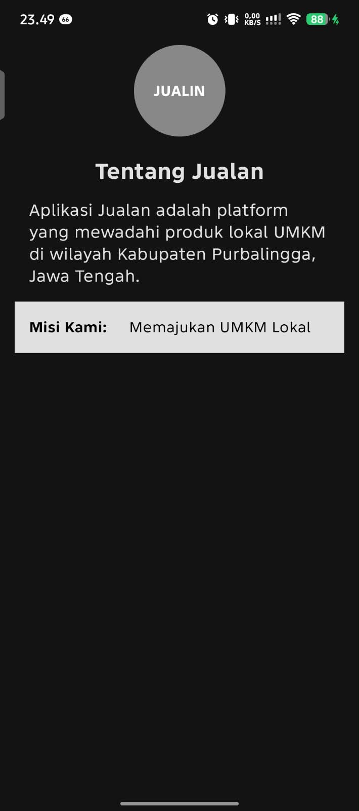
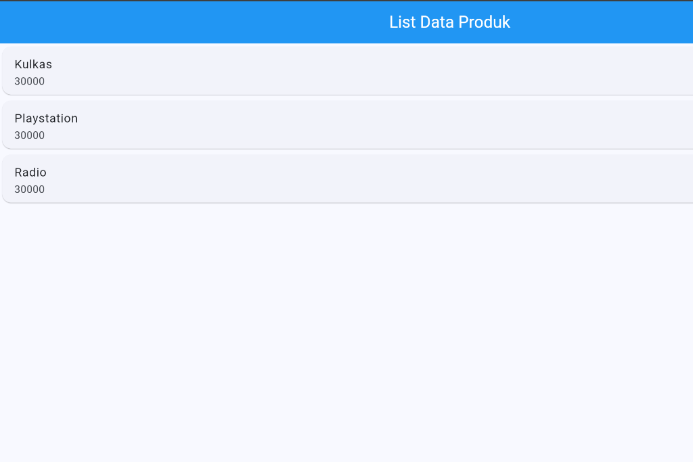
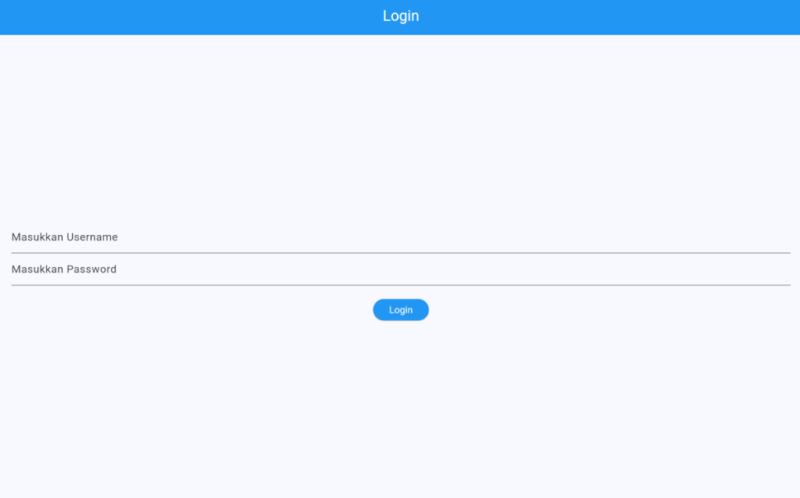
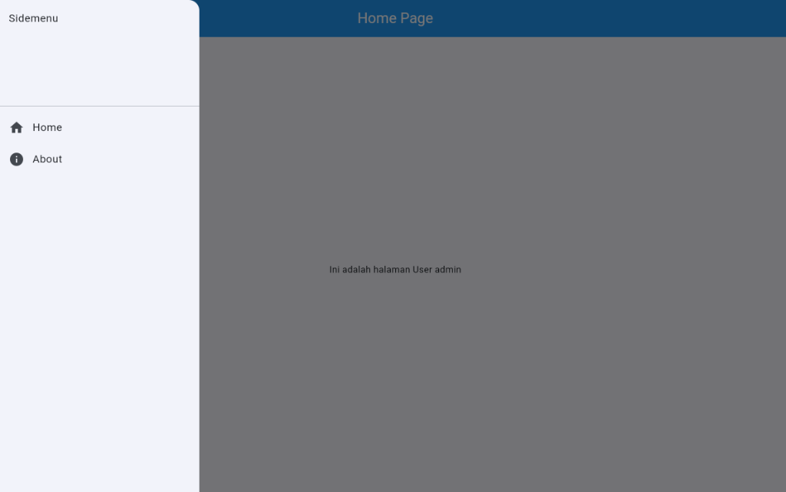
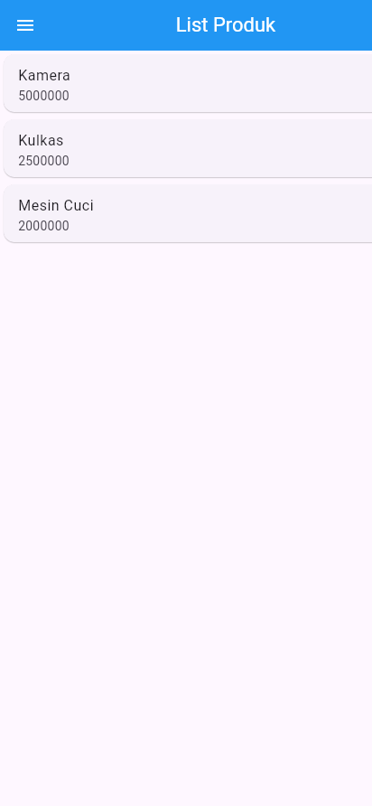
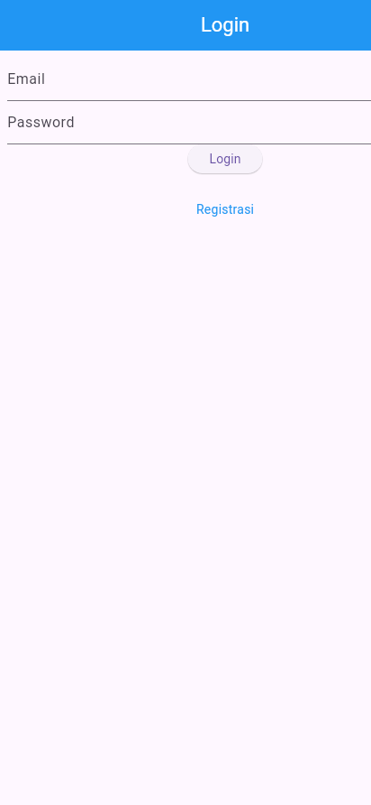

# Praktikum Pemrograman Mobile

**IDENTITAS**

Nama : Althaf Nadhif Saputra

NIM : H1D024108

Shift awal : E

Shift akhir : E

---

# Pertemuan 1

**SCREENSHOT**

  

**Deskripsi Non-Teknikal**  
Aplikasi menampilkan halaman informasi profil aplikasi Jualan yang ditujukan sebagai platform wadah bagi produk-produk UMKM lokal di Kabupaten Purbalingga. Pada layar terdapat logo aplikasi berbentuk lingkaran dengan tulisan Jualin di bagian atas, diikuti dengan judul halaman, paragraf penjelasan mengenai tujuan aplikasi, serta kotak baris khusus di bagian bawah yang memuat teks penegasan misi utama untuk memajukan UMKM lokal.

**Deskripsi Teknikal**  
Antarmuka ini dibangun menggunakan kerangka kerja Jetpack Compose pada platform Android. Tata letak elemen disusun secara vertikal menggunakan kontainer column dengan perataan di tengah layar, di mana logo dibuat memanfaatkan box dengan pemotongan bentuk lingkaran serta latar belakang abu-abu. Jarak antar komponen diatur menggunakan spacer, sedangkan bagian misi menggunakan susunan row dengan pembagian bobot proporsional agar teks misi dan penjelasannya terbagi secara rapi di dalam kotak latar abu-abu terang.

---

# Pertemuan 2

**SCREENSHOT**

  

**Deskripsi Non-Teknikal**  
Aplikasi menampilkan halaman katalog data produk dengan bilah judul berwarna biru bertuliskan "List Data Produk" pada bagian atas layar. Di bawahnya, daftar barang yang terdiri dari Kulkas, Playstation, dan Radio beserta nominal harganya masing-masing ditampilkan secara terpisah di dalam kotak kartu putih berbayang halus yang tersusun rapi dan mudah dibaca oleh pengguna.

**Deskripsi Teknikal**  
Halaman ini dibangun menggunakan widget stateful dengan menerapkan komponen list view sebagai wadah gulir untuk menyusun sekumpulan data secara vertikal. Setiap elemen item dibungkus menggunakan kartu untuk memberikan efek elevasi visual khas desain material, serta memanfaatkan komponen list tile dengan properti judul dan subjudul agar susunan teks nama produk dan harga terformat secara terstruktur dan seragam.

---

# Pertemuan 3

**SCREENSHOT**

  

  

**Deskripsi Non-Teknikal**  
Aplikasi ini memiliki halaman login untuk memasukkan username dan password. Jika data yang dimasukkan benar, pengguna akan diarahkan ke halaman utama yang menampilkan nama user yang sedang login serta memiliki menu samping untuk berpindah ke halaman lain seperti home dan about.

**Deskripsi Teknikal**  
Halaman login dibuat menggunakan form input teks untuk menangani input dari pengguna dan memanfaatkan shared preferences untuk menyimpan username ke dalam memori lokal perangkat. Untuk perpindahan antar halaman digunakan sistem navigasi route, sedangkan menu samping dibuat menggunakan komponen drawer yang berisi pilihan menu untuk berpindah halaman.

---

# Pertemuan 4

**SCREENSHOT**

  

**Deskripsi Non-Teknikal**  
Aplikasi ini menyediakan halaman registrasi dan login untuk pengguna, serta halaman utama yang menampilkan daftar produk yang dijual seperti kamera, kulkas, dan mesin cuci. Pengguna dapat melihat rincian informasi setiap produk dengan memilih item pada daftar, menambah produk baru melalui tombol tambah, maupun mengubah dan menghapus data produk yang ada melalui form produk.

**Deskripsi Teknikal**  
Aplikasi ini dibuat menggunakan struktur model data untuk menampung informasi login, registrasi, dan produk. Tampilan antarmuka menggunakan form input yang dilengkapi dengan validasi teks agar input data dari pengguna sesuai, serta komponen daftar untuk menampilkan deretan kartu produk secara teratur. Perpindahan antar tampilan seperti menuju halaman detail dan form input diatur menggunakan sistem navigasi bawaan flutter.

---

# Pertemuan 5

**SCREENSHOT**

  

**Deskripsi Non-Teknikal**  
Aplikasi kini telah terhubung langsung dengan layanan server untuk mengelola data secara dinamis. Pengguna dapat mendaftarkan akun baru melalui halaman registrasi serta masuk ke dalam sistem menggunakan halaman login dengan memasukkan email dan password. Setelah berhasil masuk, aplikasi menampilkan daftar barang yang diambil langsung dari database server, di mana pengguna dapat melihat detail produk, menambahkan barang dagangan baru, memperbarui informasi barang yang sudah ada, maupun menghapus data produk dari sistem, serta keluar dari akun melalui menu logout.

**Deskripsi Teknikal**  
Pada modul ini dilakukan integrasi aplikasi dengan layanan antarmuka pemrograman aplikasi berbasis protokol http untuk menangani seluruh proses pertukaran data secara asinkron. Pengelolaan token otentikasi dan identitas pengguna disimpan ke dalam penyimpanan lokal perangkat agar sesi login tetap tersimpan. Arsitektur aplikasi diorganisasi menggunakan pemisahan logika bisnis yang bertugas menghubungkan form antarmuka pengguna dengan endpoint server untuk operasi registrasi, login, penarikan data, pengiriman data baru, pembaruan, hingga penghapusan data, lengkap dengan dialog notifikasi untuk memberi umpan balik status berhasil atau gagal kepada pengguna.

