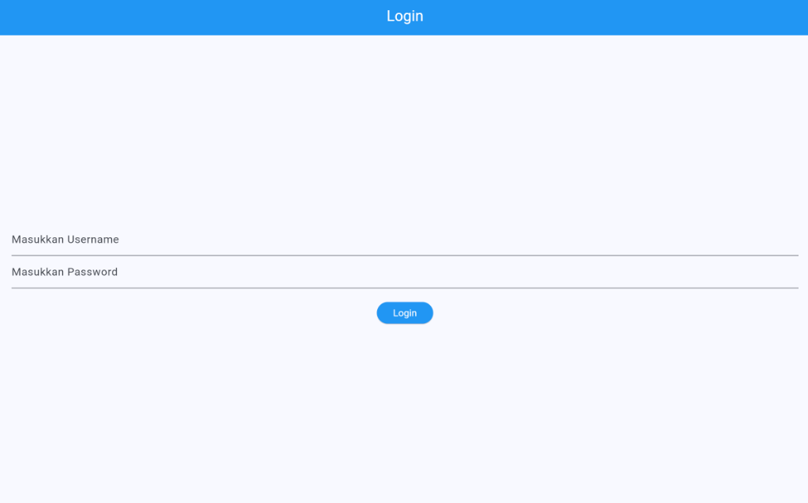
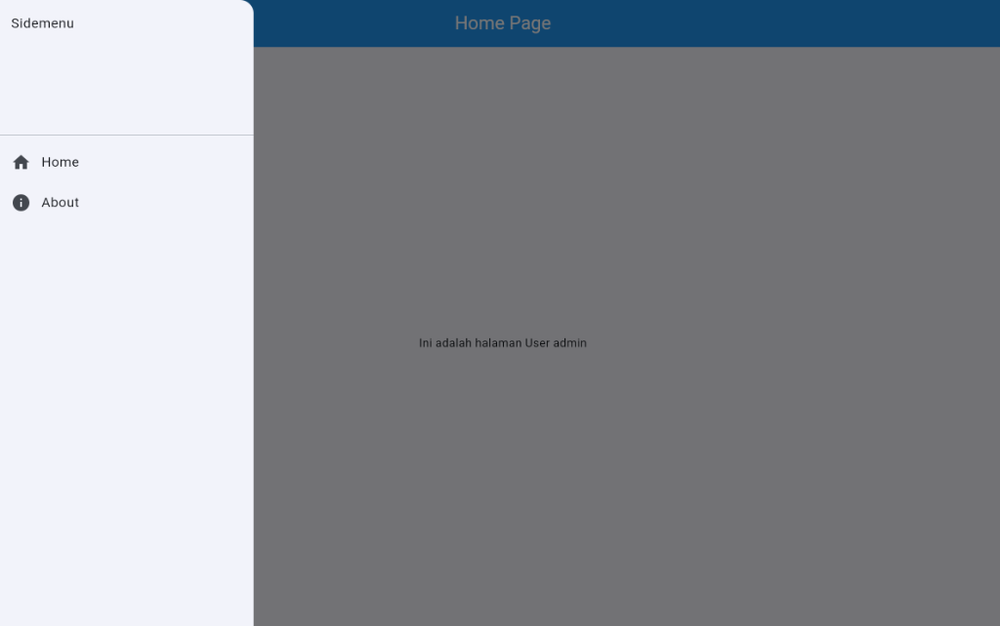

# Praktikum Pemrograman Mobile - Modul 3

**IDENTITAS**

Nama : Althaf Nadhif Saputra

NIM : H1D024108

Shift awal : E

Shift akhir : E

---

**SCREENSHOT**

  

  

**Deskripsi Non-Teknikal**  
Aplikasi ini memiliki halaman login untuk memasukkan username dan password. Jika data yang dimasukkan benar, pengguna akan diarahkan ke halaman utama yang menampilkan nama user yang sedang login serta memiliki menu samping untuk berpindah ke halaman lain seperti home dan about.

**Deskripsi Teknikal**  
Halaman login dibuat menggunakan form input teks untuk menangani input dari pengguna dan memanfaatkan shared preferences untuk menyimpan username ke dalam memori lokal perangkat. Untuk perpindahan antar halaman digunakan sistem navigasi route, sedangkan menu samping dibuat menggunakan komponen drawer yang berisi pilihan menu untuk berpindah halaman.
