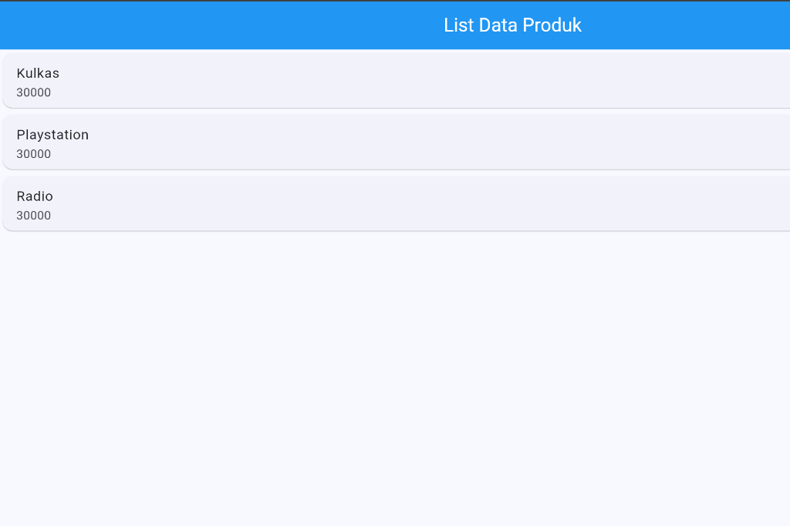

# Praktikum Pemrograman Mobile - Modul 2

**IDENTITAS**

Nama : Althaf Nadhif Saputra

NIM : H1D024108

Shift awal : H

Shift akhir : d

---

**SCREENSHOT**

  

**Deskripsi Non-Teknikal**  
Aplikasi menampilkan halaman katalog data produk dengan bilah judul berwarna biru bertuliskan "List Data Produk" pada bagian atas layar. Di bawahnya, daftar barang yang terdiri dari Kulkas, Playstation, dan Radio beserta nominal harganya masing-masing ditampilkan secara terpisah di dalam kotak kartu putih berbayang halus yang tersusun rapi dan mudah dibaca oleh pengguna.

**Deskripsi Teknikal**  
Halaman ini dibangun menggunakan StatefulWidget dengan menerapkan komponen ListView sebagai wadah scrollable untuk menyusun sekumpulan data secara vertikal. Setiap elemen item dibungkus menggunakan widget Card untuk memberikan efek elevasi visual khas Material Design, serta memanfaatkan komponen ListTile dengan properti title dan subtitle agar susunan teks nama produk dan harga terformat secara terstruktur dan seragam.
